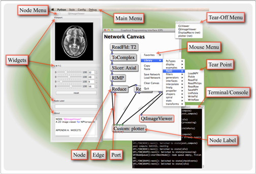
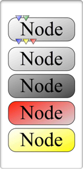

.. _ui-rst:

##############
User Interface
##############
This section covers information about how specific aspects of the UI, including
mouse interactions and keyboard shortcuts.

Canvas
======
The main GPI workspace is the *canvas*. Most of the essential tools the user
will need to construct networks and prototype algorithms are found here.

    *Figure 1* - A screen capture of an active GPI session with superimposed
    labels identifying each UI component.

GPI network manipulation tools are mostly accessible within the Mouse Menu
which can be opened by right-clicking on the Network Canvas (Fig. 1). From this
menu, nodes can be instantiated, copy/paste, saved/loaded as a network, and the
canvas can be completely cleared. Node (Python source code), network (\*.net)
files, and data files can also be dragged and dropped on the canvas from a file
browser. This will instantiate the Nodes associated with the code, network,
or data or data that has been dropped.

If GPI is launched from a terminal, all Node and Network Canvas information
will be echoed to the terminal window. This can aid in debugging runtime
errors. hat has been dropped.

Additionally, the Nodes and Ports have a color code to indicate their status
(Fig. 2). The background color code is as follows: idle (light grey), running
(dark grey), error (red), warning (yellow). Error states do not allow the Node
to be run again (the Node can be copied and pasted to retry). The warning state
(like the idle state) will allow the Node to reenter the event-loop. The input
Ports can be blue or green for required or optional input respectively. The
output Ports are blue (indicating success), yellow (unchanged), and red (no
data and no downstream event).

    *Figure 2* - Node color corresponds to state. Port colors correspond to
    state and data obligation.

As Nodes are instantiated on the canvas they briefly turn dark grey indicating
that they are running their kernel (``compute()`` function) code. As Nodes are
connected and Widgets are modified they automatically trigger ``compute()``
events which flow down connections of the network. This execution flow can be
paused by selecting ‘Pause’ from the Mouse Menu. Networks and Widgets can be
modified in pause mode and will start execution when un-paused.

Process Nodes waiting for an available worker display a static amber hourglass
instead of a processing circle. Once the worker starts the Node, the hourglass
disappears and the usual progress circle is shown for longer computations.
Time spent waiting for a worker is excluded from the progress estimate and the
Node's recorded compute time.

The Network Canvas has a tabbed interface allowing more canvases to be
instantiated and run simultaneously. Nodes can then be copied and pasted
between canvases allowing the user to easily consolidate emergent or
spontaneous design changes. Layouts, spawned from the Mouse Menu, can also be
used to tie Widgets from various Nodes together, making a single unified
‘control panel’ for networks on a single canvas. Finally, macro-Nodes can also
be used to aggregate multiple Nodes into a single representation on the canvas.
A macro-Node is instantiated from the Mouse Menu. Connections between the
‘Input’ and ‘Output’ Nodes are enveloped within the macro when either Node is
double-clicked.Mouse & Keyboard Command List: This section lists how to
interact with the display items shown in Fig. 1.

Keyboard & Mouse Controls
=========================

Network Canvas
--------------
.. csv-table::
   :header: "Key/Button", "Function"

   "Left Click", "select Nodes or drag to select multiple Nodes"
   "Middle Click + Drag", "move the Network Canvas relative to view"
   "Scroll Wheel", "zoom in and out of the Network Canvas"
   "Right Click", "Mouse Menu"
   "Tab", "cycle Node selection"
   "Ctrl/⌘+C", "copy selected Nodes"
   "Ctrl/⌘+L", "load a network"
   "Ctrl/⌘+O", "organize selected Nodes"
   "Spacebar or Ctrl/⌘+P", "pause/unpause"
   "Ctrl/⌘+R", "reload selected nodes"
   "Ctrl/⌘+S", "save a network"
   "Ctrl/⌘+T", "open a new canvas tab"
   "Ctrl/⌘+V", "paste selected Nodes"
   "Ctrl/⌘+X", "close all node menus of the current canvas tab and the console window"
   "Delete/Backspace", "delete selected Nodes"
   "Up, Down, Left, Right Arrows", "move selected Nodes across the Network Canvas"

Node Menu
---------
.. csv-table::
   :header: "Key/Button", "Function"

   "Left Click", "select Widget"
   "Left Double Click", "show/hide Widget"
   "Middle Click + Drag (Option + Left Click + Drag in OSX)", "grab Widget and
   place in a layout or macro-node menu"
   "Right Click", "open Widget-Port menu"
   "Tab", "cycle focus through Widgets"

.. _ui-keyboard:

Node
----
.. csv-table::
   :header: "Key/Button", "Function"

   "Left Click", "select Node"
   "Left Click+Drag", "move Node"
   "Right Click", "Node Menu"
   "Ctrl/⌘+Right Click", "open the Node’s python code."
   "Hover", "display compute() wall time and total outport memory used"

Macro-Node
----------
.. csv-table::
   :header: "Key/Button", "Function"

   "Left Double Click", "open/close the macro"

Edge
----
.. csv-table::
   :header: "Key/Button", "Function"

   "Right Click", "Edge delete menu"

Port
----
.. csv-table::
   :header: "Key/Button", "Function"

   "Middle Click", "raise all connectable Ports"
   "Middle Click+Drag", "draw connection Edge to another Port"
   "Right Click (InPorts)", "delete the upstream connection"
   "Hover", "display Port type and held data information"

Custom Node: Editing in VS Code
==============================

The Custom node's **Python Code** field includes **Edit in VS Code** and
**Stop VS Code Sync** controls. VS Code must be installed; on Linux and macOS,
make its ``code`` command available on PATH. On Windows, GPI also checks the
standard installation folders. A running VS Code installation takes precedence
over PATH, so an older installation on PATH does not open a different signed-in
environment. If multiple installations are running, close the unwanted one
before launching external editing. Restart GPI after changing PATH.

Click **Edit in VS Code** to add a separate temporary folder for this node to
the existing VS Code window without replacing its current folders. Open your
usual signed-in VS Code window first. GPI does not request a separate profile
or user-data directory. If VS Code is not running, it opens normally.
The folder configures GPI's Python interpreter and framework import path,
and enables Auto Save after a 500 ms pause for this folder only.
Install the Python/Pylance and GitHub Copilot extensions in VS Code as needed,
and sign in with your own Copilot account. AI features use VS Code's existing
extension, account, organization-policy, and workspace-trust settings; GPI does
not send code to an AI service itself.

Edit below the marked GPI context header in ``custom_node.py`` and keep that
header unchanged. It describes the runtime ``self`` as ``gpi.NodeAPI`` for
Python tooling and is stripped before importing code into GPI. Existing
``__future__`` imports remain above the generated header. This file is
an editing buffer, not a standalone Python program: run it with GPI's
**Compute**, not VS Code's Run Python File command.

While synchronization is active, the GPI code field is read-only. Auto Save in
VS Code updates it after a short pause (typically 1-2 seconds).
GPI checks syntax only when the node executes, not while editing.
Ctrl+S also saves immediately; use it if Auto Save is
disabled or restricted by VS Code settings or workspace trust. Unsaved editor
buffers cannot be read by GPI.
Saving, opening VS Code, and stopping synchronization do **not** execute code.
The node still responds to its normal input-port and **Compute** events.
Each Custom node has its own independent editing folder.

**Stop VS Code Sync** imports the last saved version and restores local
editing. Save before stopping: unsaved VS Code changes cannot be imported.
Closing VS Code alone does not stop synchronization. If a file cannot be
read, its context header is changed, or GPI's code is changed programmatically,
the sync status reports the problem and retains the last imported code.
Restore the file/header to resume, or stop synchronization and recover any
external edits from the displayed path before closing the node.

Save the GPI network to persist the imported code. External files are temporary
and removed when the node's code widget is destroyed or GPI exits. Reopening
external editing after stopping creates a fresh folder from GPI's current code;
old session files remain available for recovery until the node closes.
